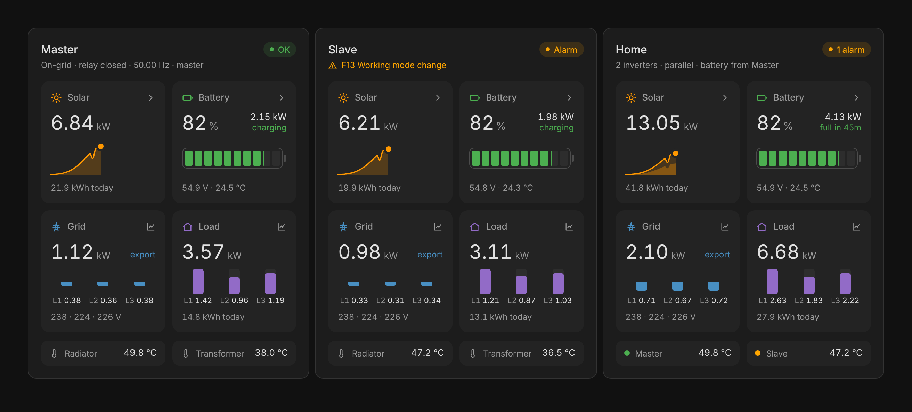
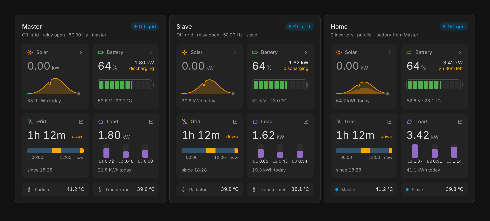
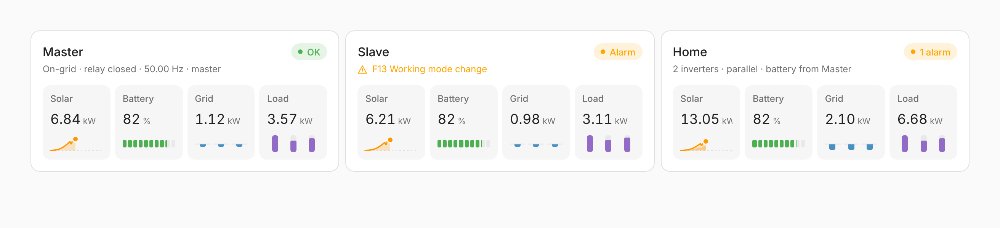
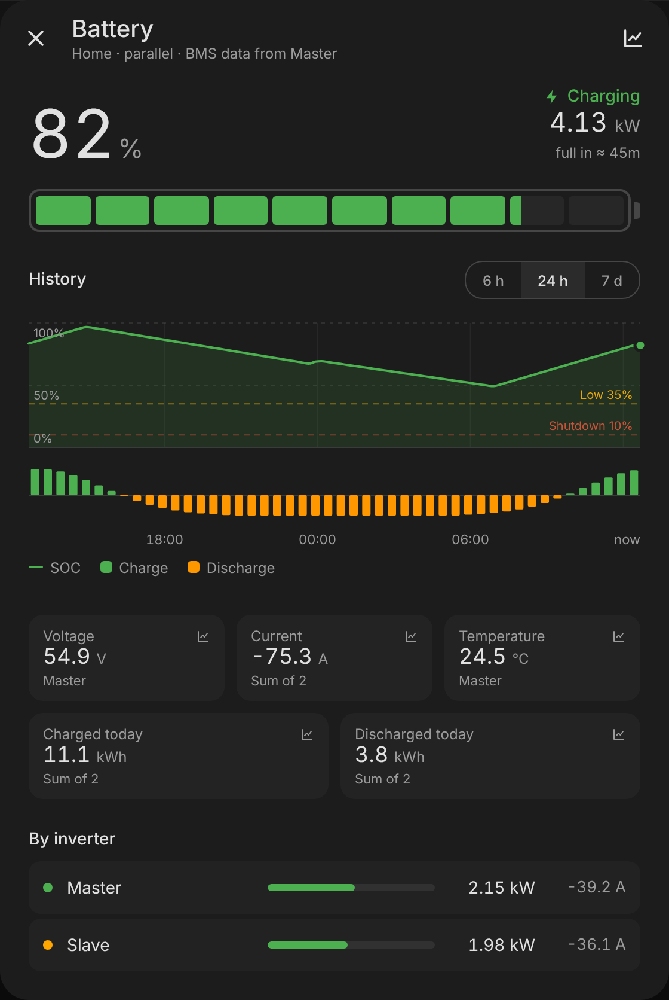
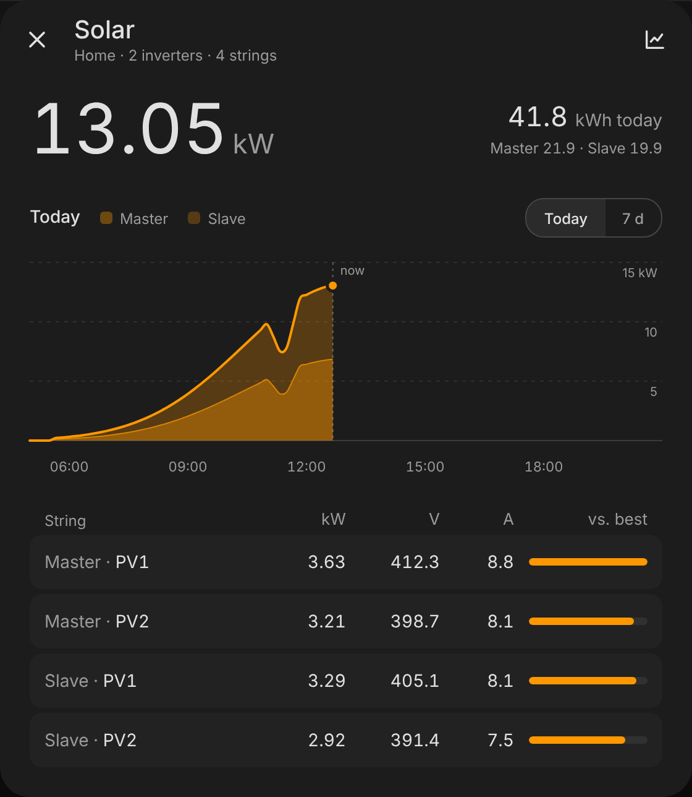

# Deye Inverter Card

[](https://hacs.xyz/docs/faq/custom_repositories)
[](https://github.com/RobinCK/lovelace-deye-inverter-card/releases)
[](https://github.com/RobinCK/lovelace-deye-inverter-card/actions/workflows/ci.yml)
[](LICENSE)

A Home Assistant Lovelace card that shows the status and live values of Deye/Sunsynk hybrid
inverters: state and faults, solar, battery, grid and load per phase, temperatures and a combined
view for inverters running in parallel.

The card is built for the
**[Sunsynk/Deye Inverter add-on](https://github.com/kellerza/sunsynk)**
([documentation](https://kellerza.github.io/sunsynk/)) by kellerza. The add-on reads the inverters
over Modbus and publishes their sensors to Home Assistant through MQTT. The card finds those sensors
automatically from each inverter's `HA_PREFIX`, so a typical setup needs only the prefixes.

Energy flow diagrams are already covered by
[sunsynk-power-flow-card](https://github.com/slipx06/sunsynk-power-flow-card); this card focuses on
inverter state and measurements and works well next to it.







| Battery popup                                                                                                        | Solar popup                                                                                                      |
| -------------------------------------------------------------------------------------------------------------------- | ---------------------------------------------------------------------------------------------------------------- |
|  |  |

## Features

- One panel per inverter with its state (OK, alarm, fault, off-grid), the fault text and a status
  line: grid connection, relay, frequency and parallel role.
- Tiles for solar (with today's production curve), battery (state of charge, charging or
  discharging, time to full or empty), grid (per phase import and export, voltage warnings outside
  207–253 V, outage duration and 24 h outage strip) and load (per phase).
- Radiator and DC transformer temperatures.
- A combined panel for two or more inverters: solar, load, grid and battery power are summed. In a
  parallel system with a shared battery, the state of charge, voltage and temperature come from the
  master inverter.
- Solar and battery popups with history (today / 7 days, 6 h / 24 h / 7 days), per string and per
  inverter breakdowns. Every value opens its Home Assistant history.
- Detailed and compact layouts, light and dark themes (only Home Assistant theme variables are
  used), responsive layout and support for sections dashboards.
- Visual editor with prefix detection, tile selection, tap actions and entity overrides.
- Missing sensors never break the card: a value or tile without a sensor is hidden.

## Requirements

- Home Assistant 2024.11 or newer.
- The [Sunsynk/Deye Inverter add-on](https://github.com/kellerza/sunsynk) (single or multi
  inverter version) publishing sensors through MQTT, with the sensors listed
  [below](#sensors) enabled in the add-on `SENSORS` option.

## Installation

### HACS (recommended)

[](https://my.home-assistant.io/redirect/hacs_repository/?owner=RobinCK&repository=lovelace-deye-inverter-card&category=plugin)

1. Click the button above, or open **HACS → ⋮ → Custom repositories** and add
   `https://github.com/RobinCK/lovelace-deye-inverter-card` with the type **Dashboard**.
2. Open **Deye Inverter Card** in HACS and click **Download**.
3. Reload the browser. HACS registers the dashboard resource automatically.

HACS shows an update whenever a new release is published. Click **Update** and reload the
browser.

### Manual

1. Download `deye-inverter-card.js` from the
   [latest release](https://github.com/RobinCK/lovelace-deye-inverter-card/releases/latest)
   (the same file is also kept in the [`dist`](dist) folder of the repository).
2. Copy it to `/config/www/deye-inverter-card.js`.
3. Open **Settings → Dashboards → ⋮ → Resources → Add resource**, enter
   `/local/deye-inverter-card.js?v=1.0.0` and choose **JavaScript module**.
4. Reload the browser.

To update, replace the file and change the `?v=` value of the resource to the new version, so
browsers load the new file instead of a cached one. The browser console prints the loaded version
as `DEYE INVERTER CARD x.y.z`.

## Configuration

Add the card from the dashboard editor (search for **Deye Inverter Card**) or in YAML.

Minimal configuration for one inverter:

```yaml
type: custom:deye-inverter-card
inverters:
  - prefix: deye_master
```

Two inverters in parallel with a combined panel:

```yaml
type: custom:deye-inverter-card
title: Home
inverters:
  - prefix: deye_master
    name: Master
  - prefix: deye_slave
    name: Slave
show_totals: true
parallel: true
master: deye_master
display: detailed
sections: [status, pv, battery, grid, load, temps]
tap_actions:
  pv: popup
  battery: popup
  grid: more-info
  load: more-info
  temps: more-info
invert:
  battery_power: false
  grid_power: false
entities:
  deye_master:
    battery_soc: sensor.custom_override
```

Put all inverters into one card: it shows a panel per inverter plus the combined panel, places
them side by side and wraps them onto new rows on narrow screens. In a sections dashboard a card
with several inverters spans the full section width by default.

### Options

| Option        | Type    | Default                         | Description                                                                                           |
| ------------- | ------- | ------------------------------- | ----------------------------------------------------------------------------------------------------- |
| `inverters`   | list    | **required**                    | Inverters to show, see [Inverter options](#inverter-options).                                         |
| `title`       | string  | `Total`                         | Name of the combined panel.                                                                           |
| `display`     | string  | `detailed`                      | `detailed` or `compact`.                                                                              |
| `show_totals` | boolean | `true`                          | Show the combined panel when there are two or more inverters.                                         |
| `parallel`    | boolean | `true`                          | Inverters share one battery. SOC, voltage and temperature of the combined panel come from the master. |
| `master`      | string  | first inverter                  | Prefix of the master inverter. Used for shared battery values, grid voltages and the off-grid state.  |
| `sections`    | list    | all                             | Parts to show: `status`, `pv`, `battery`, `grid`, `load`, `temps`.                                    |
| `tap_actions` | map     | see [Tap actions](#tap-actions) | Action per tile: `pv`, `battery`, `grid`, `load`, `temps`.                                            |
| `invert`      | map     | `false`                         | Sign conventions: `battery_power`, `grid_power`. See [Sign conventions](#sign-conventions).           |
| `entities`    | map     | –                               | Entity overrides per prefix, see [Entity overrides](#entity-overrides).                               |

### Inverter options

| Option   | Type   | Default      | Description                                    |
| -------- | ------ | ------------ | ---------------------------------------------- |
| `prefix` | string | **required** | The `HA_PREFIX` of the inverter in the add-on. |
| `name`   | string | prefix       | Name shown in the panel header.                |

The add-on creates entities named `<domain>.<prefix>_<key>`, for example
`sensor.deye_master_battery_soc`. The card looks for each key in the `sensor`, `binary_sensor` and
`number` domains as listed in the [sensor table](#sensors).

### Tap actions

| Value       | Description                                                        |
| ----------- | ------------------------------------------------------------------ |
| `popup`     | Opens the card popup. Available for `pv` and `battery`.            |
| `more-info` | Opens the Home Assistant more-info dialog with the sensor history. |
| `none`      | Does nothing.                                                      |

Defaults: `pv` and `battery` open the popup, `grid`, `load` and `temps` open more-info. Values
inside a popup always open their sensor history.

### Sign conventions

By default the card follows the add-on: positive `battery_power` means discharging and negative
means charging; positive `grid_power` means import and negative means export. If your sensors use
the opposite sign, set `invert.battery_power` or `invert.grid_power` to `true`. The battery option
also applies to `battery_current`; the grid option applies to `grid_ct_power` and the per phase
grid power.

### Entity overrides

Any key can point to another entity. Overrides are set per prefix:

```yaml
entities:
  deye_master:
    battery_soc: sensor.bms_soc
    grid_power: sensor.grid_meter_power
```

Power sensors may be in `W`, `kW` or `MW` and energy sensors in `Wh`, `kWh` or `MWh`; the card
converts them using the entity's unit.

## Sensors

Enable these sensors in the add-on `SENSORS` option. Every sensor is optional: when one is missing,
the related value or tile is hidden.

| Section          | Keys                                                                                                                                                        |
| ---------------- | ----------------------------------------------------------------------------------------------------------------------------------------------------------- |
| Status           | `overall_state`, `fault`, `grid_connected`¹, `grid_relay_status`¹, `parallel_mode`                                                                          |
| Solar            | `pv_power`, `pv1_power`, `pv2_power`, `pv1_voltage`, `pv2_voltage`, `pv1_current`, `pv2_current`, `day_pv_energy`                                           |
| Battery          | `battery_soc`, `battery_power`, `battery_voltage`, `battery_current`, `battery_temperature`, `day_battery_charge`, `day_battery_discharge`                  |
| Battery settings | `battery_capacity_current`², `battery_low_capacity`², `battery_shutdown_capacity`²                                                                          |
| Grid             | `grid_power`, `grid_ct_power`, `grid_l1_power`…`grid_l3_power`, `grid_l1_voltage`…`grid_l3_voltage`, `grid_frequency`, `day_grid_import`, `day_grid_export` |
| Load             | `load_power`, `load_l1_power`…`load_l3_power`, `load_l1_voltage`…`load_l3_voltage`, `load_frequency`, `day_load_energy`                                     |
| Temps            | `radiator_temperature`, `dc_transformer_temperature`                                                                                                        |

¹ `binary_sensor` domain. ² `number` domain (add-on settings).

How the values are used:

- **Solar**: `pv_power`, or the sum of `pv1_power` and `pv2_power` when `pv_power` is missing.
- **Battery**: the low and shutdown capacities color the state of charge (defaults 35 % and 10 %).
  The time to full or empty needs `battery_capacity_current` (Ah) and `battery_voltage`, and is
  shown when a panel represents the whole battery (a single inverter or the combined panel).
- **Grid**: `grid_power`, or `grid_ct_power` when `grid_power` is missing. When `grid_connected`
  is off, the tile shows how long the grid has been down and the outages of the last 24 hours.
- **Status line**: the frequency comes from `grid_frequency` on grid and from `load_frequency` off
  grid.

History charts use the Home Assistant recorder. The 7 day charts use long term statistics, which
the add-on provides for power and state of charge sensors.

## Development

```bash
npm ci
```

```bash
npm run watch
```

`npm run watch` rebuilds `dist/deye-inverter-card.js` on every change. Copy or link it to
`/config/www/` of a test instance.

```bash
npm run lint
```

```bash
npm test
```

```bash
npm run build
```

The built `dist/deye-inverter-card.js` is committed, so the repository can be used directly.

### Releases

1. Update `version` in `package.json` and run `npm run build`.
2. Commit the change, including `dist/deye-inverter-card.js`, and push it to `main`.
3. Run the **Release** workflow from the Actions tab, or push a tag that matches the version, for
   example `v1.1.0`.

The release workflow builds the card, creates the `v<version>` tag and publishes a GitHub release
with `deye-inverter-card.js` attached. HACS picks the release up as an update.

## Other Home Assistant projects

- [Blackout](https://github.com/RobinCK/blackout) — integration for planned and emergency power outages in Ukraine: schedules for 21 regions, the Ukrenergo grid state, outage history and dashboard cards.
- [Sirio Pump Inverter (WiNET)](https://github.com/RobinCK/ha-sirio-winet) — local integration for Italtecnica Sirio pump inverters with the WiNET Wi-Fi module, with a pressure gauge card.
- [Klimo](https://github.com/RobinCK/klimo) — add-on for room-by-room heating and cooling: heat pumps, boilers, air conditioners, heaters and circulation pumps.
- [Zroshua](https://github.com/RobinCK/zroshua) — add-on for smart irrigation: zones, schedules, weather, rain and soil sensors and a live site map.
- [Metron](https://github.com/RobinCK/lovelace-metron) — thirty Lovelace cards for energy, solar, battery, gas and money.
- [Phase Pair Card](https://github.com/RobinCK/lovelace-phase-pair-card) — Lovelace card for three-phase homes: voltage and power before and after the voltage stabilizers, phase balance.
- [Deck Card](https://github.com/RobinCK/lovelace-deck-card) — adaptive container card that groups cards into segments: pills on wide screens, swipe on phones.
- [Osnova](https://github.com/RobinCK/osnova) — theme for the whole Home Assistant interface with a Ukrainian cross-stitch ornament.
- [Solax2HA](https://github.com/RobinCK/solax2ha) — service that sends Solax inverter data to Home Assistant sensors.

## License

[MIT](LICENSE)
